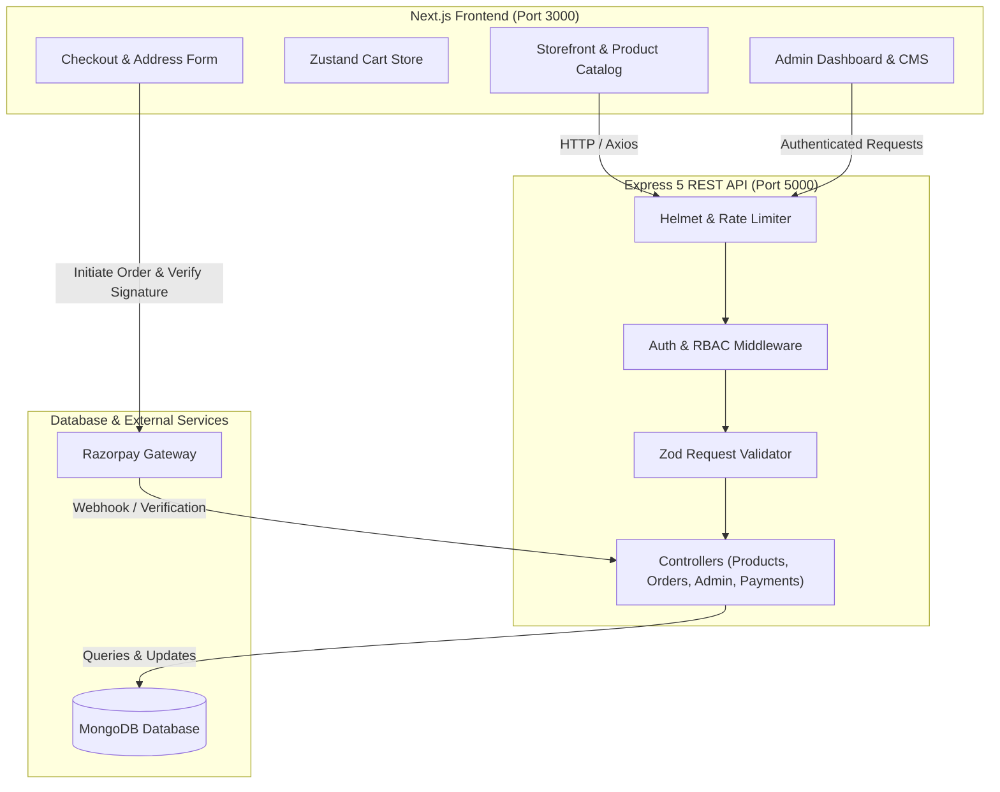

# 🏭 Vintage Factory — Modern Full-Stack E-Commerce Platform

<p align="center">
  
</p>

<p align="center">
  <b>A high-performance, full-stack e-commerce marketplace and reselling management system.</b><br>
  Built with Next.js App Router, Tailwind CSS, Express.js, MongoDB, Zustand, and Razorpay.
</p>

<p align="center">
  <a href="https://nextjs.org"></a>
  <a href="https://react.dev"></a>
  <a href="https://expressjs.com"></a>
  <a href="https://www.mongodb.com"></a>
  <a href="https://tailwindcss.com"></a>
  <a href="https://razorpay.com"></a>
  
</p>

---

## 📖 Table of Contents

- [Overview](#-overview)
- [Key Features](#-key-features)
  - [Customer Storefront](#-customer-storefront)
  - [Cart & Checkout](#-cart--checkout)
  - [Admin Management Suite](#-admin-management-suite)
  - [Security & Architecture](#-security--architecture)
- [Tech Stack](#-tech-stack)
- [System Architecture](#-system-architecture)
- [Project Structure](#-project-structure)
- [Getting Started](#-getting-started)
  - [Prerequisites](#prerequisites)
  - [1. Clone Repository](#1-clone-repository)
  - [2. Backend Setup](#2-backend-setup)
  - [3. Frontend Setup](#3-frontend-setup)
- [Environment Variables](#-environment-variables)
- [API Reference](#-api-reference)
- [Git Workflow & Branching](#-git-workflow--branching)
- [License](#-license)

---

## 🌟 Overview

**Vintage Factory** is an end-to-end e-commerce platform engineered for seamless shopping and supplier-assisted fulfillment. Designed with a sleek, user-centric interface and backed by an Express REST API, it empowers customers with lightning-fast product discovery, responsive category filtering, and instant Razorpay checkout.

For store owners, Vintage Factory provides a dedicated **Admin Dashboard** featuring real-time revenue analytics, bulk CSV catalog imports, automated margin/markup pricing adjustments, promotional banner scheduling, and order status fulfillment tracking.

---

## ✨ Key Features

### 🛍️ Customer Storefront
- **Dynamic Hero Banner Slider**: Configurable promotional carousels fetched directly from the database.
- **Categorized Browsing**: Instant navigation across Men, Women, Electronics, Footwear, Home Decor, Accessories, and more.
- **Product Exploration Tabs**: Switch effortlessly between *Trending*, *Budget Buys*, and *Top Rated* items.
- **Search & Advanced Filters**: Real-time query matching, category-based drill-downs, and sorting (price low-to-high, rating, newest).
- **Rich Product Detail Pages**: High-resolution image galleries, price discounts & MRP comparisons, variant/size selectors, delivery badges, and verified buyer reviews.

### 🛒 Cart & Checkout Flow
- **Stateful Shopping Cart**: Powered by Zustand with persistent local storage.
- **Variant & Quantity Controls**: Add, update, and remove items with automated total calculations.
- **Streamlined Checkout**: Clean multi-step shipping address collection with field validation.
- **Secure Payment Gateway**: Native Razorpay integration supporting UPI, credit/debit cards, net banking, plus Cash on Delivery (COD).
- **Post-Purchase Tracking**: Instant order success receipts and personal order history page.

### 💼 Admin Management Suite
- **Interactive Analytics Dashboard**: Instant snapshot of daily orders, pending fulfillments, and gross revenue.
- **Catalog Management**: Full CRUD operations on products with slug generation and variant inventory tracking.
- **CSV Bulk Import**: Bulk upload hundreds of products via CSV with automated validation schema via Zod.
- **Bulk Markup Tool**: Adjust retail prices storewide using percentage (`+15%`) or flat (`+₹100`) profit margins.
- **Order Fulfillment Pipeline**: Inspect order details, reference supplier URLs, update tracking numbers, and transition order states (`placed` ➔ `confirmed` ➔ `shipped` ➔ `delivered` ➔ `cancelled`).
- **Promotional Banner Manager**: Create, reorder, and toggle banner visibility with custom action links.

### 🛡️ Security & Architecture
- **JWT Authentication via HTTP-Only Cookies**: Prevents XSS-based token theft.
- **Role-Based Access Control (RBAC)**: Route-level guards protecting administrative endpoints.
- **Robust Security Headers**: Hardened with Helmet and strict CORS configurations.
- **API Rate Limiting**: Dedicated rate-limiters for authentication (`100 req/15min`) and general APIs (`3000 req/15min`).
- **Schema Validation**: Server-side request sanitization using Zod.

---

## 🛠️ Tech Stack

| Layer | Technologies |
| :--- | :--- |
| **Frontend Framework** | [Next.js 16](https://nextjs.org/) (App Router, React 19) |
| **Styling & UI** | [Tailwind CSS v4](https://tailwindcss.com/), [Lucide React Icons](https://lucide.dev/), [React Hot Toast](https://react-hot-toast.com/) |
| **State Management** | [Zustand](https://zustand-demo.pmnd.rs/) (Client-side Cart & Auth Stores) |
| **HTTP Client** | [Axios](https://axios-http.com/) |
| **Backend Runtime** | [Node.js](https://nodejs.org/) & [Express 5](https://expressjs.com/) |
| **Database & ODM** | [MongoDB](https://www.mongodb.com/) via [Mongoose](https://mongoosejs.com/) |
| **Authentication** | JSON Web Tokens (`jsonwebtoken`) & `bcryptjs` password hashing |
| **Payments** | [Razorpay](https://razorpay.com/) Node SDK & Webhook verification |
| **Validation** | [Zod](https://zod.dev/) |
| **Data Parsing** | `csv-parser` & `multer` for memory file processing |

---

## 🏗️ System Architecture



---

## 📂 Project Structure

```plaintext
vintagefactory/
├── .gitignore                    # Global git ignore configuration
├── README.md                     # Root project documentation
│
├── backend/                      # Express.js REST API
│   ├── config/
│   │   └── db.js                 # MongoDB connection setup
│   ├── controllers/
│   │   ├── adminController.js    # Admin analytics, CSV import, bulk markup
│   │   ├── authController.js     # User registration, login, logout, verification
│   │   ├── bannerController.js   # Banner management
│   │   ├── orderController.js    # Customer orders & history
│   │   ├── paymentController.js  # Razorpay order generation & signature verification
│   │   └── productController.js  # Public catalog search, filters, and categories
│   ├── middleware/
│   │   ├── auth.js               # JWT cookie parser & admin RBAC guard
│   │   ├── errorHandler.js       # Global error handler & async wrapper
│   │   └── validate.js           # Generic Zod validation middleware
│   ├── models/
│   │   ├── Banner.js             # Promotional slider schema
│   │   ├── Order.js              # Order schema with address & line items
│   │   ├── Product.js            # Product schema with variants & supplier metrics
│   │   ├── Review.js             # Customer ratings and comments
│   │   └── User.js               # User accounts and roles
│   ├── routes/                   # Modular Express route definitions
│   ├── scripts/
│   │   └── seedAdmin.js          # Admin account creation script
│   ├── .env.example              # Environment variables template
│   ├── package.json
│   └── server.js                 # Backend server entry point
│
└── client/                       # Next.js 16 Frontend App
    ├── public/
    │   └── logo.jpg              # Brand asset
    ├── src/
    │   ├── app/
    │   │   ├── admin/            # Admin routes (Dashboard, Products, Orders, Banners)
    │   │   ├── cart/             # Shopping cart page
    │   │   ├── checkout/         # Multi-step checkout & payment
    │   │   ├── login/ & register/# Customer authentication pages
    │   │   ├── orders/           # Customer order tracking
    │   │   ├── products/         # Product catalog & single product details ([slug])
    │   │   ├── layout.jsx        # Root application layout
    │   │   └── page.jsx          # Homepage with HeroSlider & CategoryTabs
    │   ├── components/
    │   │   ├── admin/            # Admin navigation and widgets
    │   │   ├── Footer.jsx        # Storefront footer
    │   │   ├── HeroSlider.jsx    # Animated banner carousel
    │   │   ├── Navbar.jsx        # Responsive navigation bar with search & cart count
    │   │   ├── ProductCard.jsx   # Product card component
    │   │   └── SafeImage.jsx     # Resilient image loader with fallback handling
    │   ├── lib/
    │   │   ├── api.js            # Axios client with credentials support
    │   │   └── utils.js          # Class name utilities
    │   └── store/
    │       ├── authStore.js      # Global authentication state
    │       └── cartStore.js      # Global cart state with localStorage persistence
    ├── next.config.ts            # Next.js configuration (remote image patterns)
    └── package.json
```

---

## 🚀 Getting Started

### Prerequisites

Ensure you have the following installed on your local machine:
- [Node.js](https://nodejs.org/) (v18.x or v20.x recommended)
- [MongoDB](https://www.mongodb.com/try/download/community) (Local instance or MongoDB Atlas connection string)
- [Git](https://git-scm.com/)

---

### 1. Clone Repository

```bash
git clone https://github.com/arjuntopscore/Vintage-Factory.git
cd Vintage-Factory
```

---

### 2. Backend Setup

1. Navigate to the backend directory:
   ```bash
   cd backend
   ```

2. Install backend dependencies:
   ```bash
   npm install
   ```

3. Configure environment variables:
   ```bash
   cp .env.example .env
   ```
   *(Update your `.env` file with your MongoDB URI, JWT secret, and Razorpay API credentials)*

4. Seed the initial Administrator Account:
   ```bash
   npm run seed:admin
   ```

5. Start the backend development server:
   ```bash
   npm run dev
   # Server runs on http://localhost:5000
   ```

---

### 3. Frontend Setup

1. Open a new terminal and navigate to the client directory:
   ```bash
   cd client
   ```

2. Install frontend dependencies:
   ```bash
   npm install
   ```

3. Start the Next.js development server:
   ```bash
   npm run dev
   ```

4. Open your browser and navigate to:
   ```
   http://localhost:3000
   ```

---

## 🔑 Environment Variables

### Backend Configuration (`backend/.env`)

| Variable | Description | Example / Default |
| :--- | :--- | :--- |
| `PORT` | Backend server port | `5000` |
| `MONGO_URI` | MongoDB connection URI | `mongodb://localhost:27017/vintagefactory` |
| `JWT_SECRET` | Secret key used to sign JWT tokens | `super_secret_jwt_key_here` |
| `CLIENT_URL` | Allowed frontend origin for CORS | `http://localhost:3000` |
| `RAZORPAY_KEY_ID` | Razorpay Key ID | `rzp_test_...` |
| `RAZORPAY_KEY_SECRET` | Razorpay Secret Key | `your_razorpay_secret` |
| `RAZORPAY_WEBHOOK_SECRET` | Secret for verifying Razorpay webhooks | `your_webhook_secret` |
| `ADMIN_EMAIL` | Default administrator email for seeding | `admin@example.com` |
| `ADMIN_PASSWORD` | Default administrator password for seeding | `securepassword` |

### Frontend Configuration (`client/.env.local` - Optional)

| Variable | Description | Default |
| :--- | :--- | :--- |
| `NEXT_PUBLIC_API_URL` | Express API base URL | `http://localhost:5000/api` |

---

## 📡 API Reference

### 🔐 Authentication (`/api/auth`)
- `POST /api/auth/register` — Register a new customer
- `POST /api/auth/login` — Customer login & JWT cookie issuance
- `POST /api/auth/logout` — Clear auth cookie
- `GET /api/auth/me` — Fetch currently authenticated user session

### 📦 Products & Catalog (`/api/products`)
- `GET /api/products` — Retrieve products (supports `q`, `category`, `sort`, `page`, `limit`)
- `GET /api/products/categories` — List distinct product categories
- `GET /api/products/:slug` — Retrieve single product details with reviews
- `POST /api/products/:id/reviews` — Add product rating & review

### 🛒 Orders (`/api/orders`)
- `POST /api/orders` — Place a new customer order
- `GET /api/orders/my-orders` — Get current customer's order history

### 💳 Payments (`/api/payment`)
- `POST /api/payment/create-order` — Generate Razorpay Order ID
- `POST /api/payment/verify` — Verify Razorpay cryptographic signature and confirm payment

### 🛠️ Admin Management (`/api/admin`) *(Admin Role Required)*
- `GET /api/admin/stats` — Retrieve revenue, pending orders, and order counts
- `GET /api/admin/products` — Fetch complete product inventory
- `POST /api/admin/products` — Create a new product listing
- `PUT /api/admin/products/:id` — Update product details
- `DELETE /api/admin/products/:id` — Delete a product
- `POST /api/admin/products/import-csv` — Bulk import products via CSV file
- `POST /api/admin/products/bulk-markup` — Apply percentage or flat markup across selected products
- `GET /api/admin/orders` — View all customer orders with filtering
- `GET /api/admin/orders/:id` — Get full order details (includes supplier reference)
- `PUT /api/admin/orders/:id/status` — Update fulfillment status and tracking number

### 🎨 Banners (`/api/banners`)
- `GET /api/banners` — Fetch active promotional banners
- `POST /api/banners` — Create a new banner *(Admin only)*
- `DELETE /api/banners/:id` — Remove banner *(Admin only)*

---

## 🌿 Git Workflow & Branching

This project follows a structured branch workflow:

- **`main`**: The primary showcase branch. Contains stable release snapshots, full documentation, setup guides, and project overviews.
- **`development`**: The active engineering branch. Houses the complete working codebase, frontend modules, backend services, database schemas, and integration pipelines.

To contribute or inspect the latest development builds:
```bash
git checkout development
git pull origin development
```

---

## 📄 License

This project is licensed under the [ISC License](LICENSE).

<p align="center">
  Crafted with ❤️ by <a href="https://github.com/arjuntopscore">Arjun K</a>
</p>
